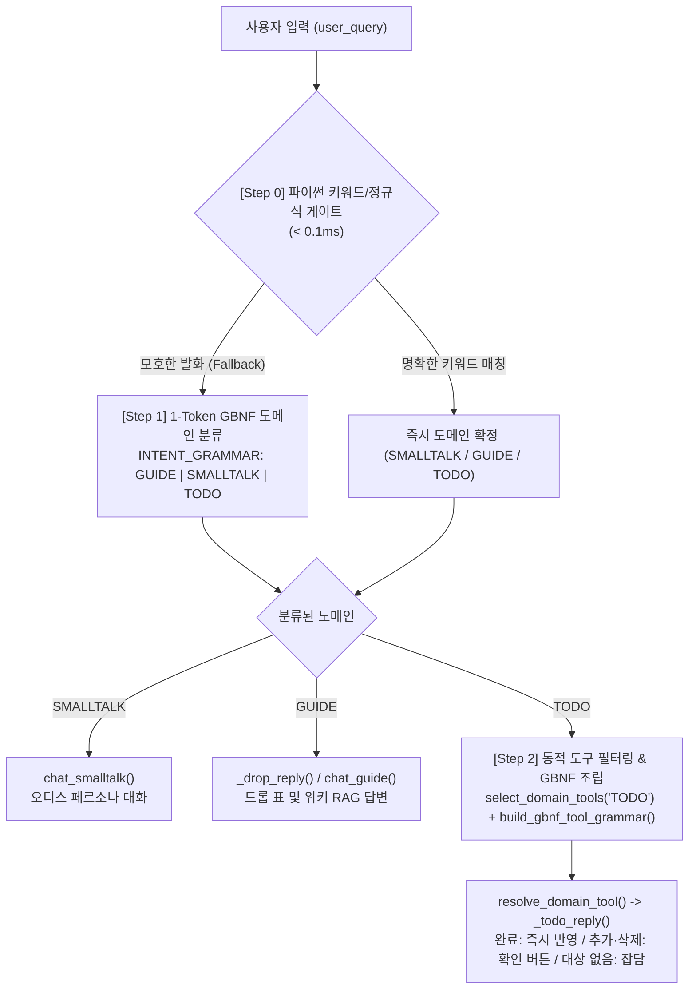

# 🛰️ Warframe Optimizer / Desktop Companion 프로젝트 인수인계서 (Handover Guide)

> **문서 최종 업데이트**: 2026-11-06  
> **프로젝트 버전**: v3.2 (Hybrid 1-Token GBNF Domain Classification, Dynamic Tool Grammar & Saved Build/Riven Suite)  
> **담당자**: Cephalon Ordis Development Team  

---

## 1. 📌 프로젝트 개요 (Overview)

본 프로젝트는 워프레임(Warframe) 플레이어를 보조하기 위한 **AI 데스크톱 컴패니언 (Cephalon Ordis 페르소나)** 시스템입니다.
카카오톡 스타일의 1:1 대화형 UI를 통해 실시간 월드 이벤트 체크리스트를 제공하며, RAG 기반 인게임 위키 가이드·드롭 테이블 질의응답, 그리고 인게임 모딩 및 리벤 리롤 스크린샷을 분석하여 실전 DPS 및 화력을 진단하는 수학 엔진을 탑재하고 있습니다.

### 핵심 기능 매트릭스
1. **스마트 챗봇 & 하이브리드 GBNF 3-Tier 엄격 라우팅**:
   - **[Step 0] 파이썬 초고속 키워드/정규식 게이트 (< 0.1ms)**: 명확한 인사, 함선 상태 점검, 공략 키워드, 정형 숙제 명령(`출격 완료`, `집정관 삭제` 등)을 LLM 호출 없이 즉시 처리.
   - **[Step 1] 1-Token 도메인 분류 (`INTENT_GRAMMAR`, 실측 약 110~190ms)**: 키워드로 확정되지 않는 모호한 발화에 대해 라벨 정의와 예시만 담은 짧은 프롬프트(`INTENT_PROMPT`)와 `llama.cpp` GBNF 문법 제약(`root ::= "GUIDE" | "SMALLTALK" | "TODO"`)을 적용하여 사족 없이 단 1단어만 생성 후 즉시 종료.
   - **[Step 2] 동적 도구 필터링 & GBNF 문법 조립**: 분류된 도메인에 해당하는 도구만 압축 선별(`select_domain_tools`)하고 JSON 스키마를 강제하는 GBNF 문법(`build_gbnf_tool_grammar`)을 동적으로 조립하여 2B 소형 모델에서도 형식이 맞는 도구 호출(`resolve_domain_tool` → `LLMOrchestrator._todo_reply`)을 얻습니다. 기존 항목 완료만 즉시 실행하고, 추가·삭제는 확인 버튼을 거칩니다.
2. **3대 응답 도메인**:
   - **SMALLTALK (잡담/일상 대화)**: 세팔론 오디스 특유의 위트 있는 글리치(Glitch) 페르소나 응답 (8모드 빌드 강제 생성 금지).
   - **GUIDE (게임 공략/드롭 표/RAG 질의응답)**: `rules/wiki_docs/` 글자 조각 BM25 검색 및 `drops_all.json` 드롭 테이블 기반으로 미션, 보스, 속성 약점, 파밍처를 안내하고 근거 문서를 표기.
   - **TODO (숙제/할 일 관리)**: 실시간 월드 상태 연동 체크리스트 추가·완료·삭제 및 계획 발화 인라인 등록 버튼 제공.
3. **스크린샷 모딩 진단 & 빌드 저장·리벤 리롤 비교**:
   - YOLOv8n 슬롯 검출(`models/slot_detector.pt`) + Windows 네이티브 OCR(`winocr`) + 자모 분해 퍼지 매칭으로 장착 모드, 아케인, 좌측 스탯 패널 정밀 판독.
   - 무기별 빌드 저장(`data/user_builds.json`), 리벤 리롤 화면 좌/우 옵션 자동 비교(`compare_riven_rolls`), 저장된 빌드 채팅 조회(`쿠바 자르에 뭐 꼈어?`, `나타루크 DPS 얼마야?`).
4. **단기 대화 세션 메모리 (`ShortTermMemory` & 동적 컨텍스트 조절)**:
   - 기본 `4k` (4,096 토큰) 슬라이딩 윈도우 및 대명사(`거기서`, `그거`, `그 무기`) 문맥 복원.
   - `/메모리 2k | 4k | 8k` 명령어로 VRAM 점유량과 기억 깊이를 실시간 전환.

---

## 2. 🧠 [핵심 아키텍처] 1-Token GBNF 도메인 분류 & 동적 도구 문법 파이프라인

2B 파라미터 온디바이스 모델(`google_gemma-4-E2B-it-Q4_K_M.gguf`)에 모든 도구 설명서를 한꺼번에 주입하면 프롬프트 과부하와 JSON 포맷 깨짐이 발생합니다. 이를 해결하기 위해 **`scripts/llm_orchestrator.py`**와 **`scripts/world_state_tracker.py`**에 2단계 GBNF 제약 파이프라인이 구현되어 있습니다.

### 파이프라인 흐름도


### Step 1: 1-Token 도메인 분류 (`LLMOrchestrator.classify_intent`)
- **위치**: `scripts/llm_orchestrator.py`
- **동작 원리**:
  - 도구 설명서 없이 세 라벨의 한 줄 정의와 예시 6개만 담은 `INTENT_PROMPT`를 전송합니다. 2B 모델은 라벨 이름만으로는 뜻을 추측해야 하기 때문입니다.
  - `INTENT_GRAMMAR = 'root ::= "GUIDE" | "SMALLTALK" | "TODO"'`를 `llama-server`의 `grammar` 필드에 전달하여 모델이 사족("안녕하세요! 이 질문은...")을 생성하지 못하고 오직 지정된 도메인 단어 1개만 출력한 뒤 즉시 정지(`max_tokens: 4`, `temperature: 0.0`)하도록 강제합니다.
  - 응답이 세 라벨과 정확히 일치할 때만 채택하고, 아니면 키워드 규칙의 기본값(문서 적중 시 GUIDE, 아니면 SMALLTALK)을 씁니다.

### Step 2: 동적 도구 필터링 & GBNF 문법 조립 (`select_domain_tools`, `resolve_domain_tool`)
- **위치**: `scripts/llm_orchestrator.py`, `scripts/world_state_tracker.py`
- **동작 원리**:
  1. **도구 압축 선별 (`select_domain_tools(domain)`)**:
     - 전체 도구 레지스트리(`DOMAIN_TOOLS`)에서 현재 도메인에 속하지 않는 도구는 프롬프트에서 완전히 제외합니다.
     - 예: `TODO` 도메인일 때 `GUIDE` 도구(`search_wiki`, `lookup_drop`)를 배제하고 오직 `add_todo`, `complete_todo`, `delete_todo` 3개만 추출합니다.
  2. **GBNF 문법 동적 조립 (`build_gbnf_tool_grammar(tools)`)**: 도구마다 자기 인자만 허용하는 규칙을 따로 만듭니다(예: `search_wiki`는 `query`만, `lookup_drop`은 `item`만). 규칙 이름에는 `_`를 쓸 수 없어 `-`로 바꿉니다.
     ```bnf
     root ::= "{" ws "\"tool\":" ws ( call-add-todo | call-complete-todo | call-delete-todo ) ws "}"
     call-add-todo ::= "\"add_todo\"" "," ws "\"args\":" ws "{" ws "\"task\":" ws string ws "}"
     ...
     string ::= "\"" [^"\\\r\n]{1,40} "\""
     ws ::= [ \t\n]{0,2}
     ```
     문자열과 공백 길이를 제한해 `max_tokens`에서 JSON이 잘리지 않게 합니다. 응답의 인자 이름이 그 도구의 `args`와 정확히 같을 때만 채택합니다.
  3. **안전한 실행 (`LLMOrchestrator._todo_reply` → `WorldStateTracker.plan_todo_tool` / `execute_todo_tool`)**:
     - `plan_todo_tool()`이 아무것도 바꾸지 않고 작업명 정제(`_clean_task_name`)와 대상 항목 검증(`_find_item`)을 합니다.
     - `complete_todo`: 기존 항목이 있으면 바로 완료 처리합니다(`TODO_DONE`).
     - `add_todo`, `delete_todo`: 확인 버튼이 달린 `TODO_CONFIRM` 응답을 돌려주고, 사용자가 누를 때만 반영합니다.
     - 대상 항목을 찾지 못하면 아무것도 바꾸지 않고 잡담으로 답합니다.
     - 앱에서는 `orchestrator.todo_tracker = tracker`로 연결되어 있어야 합니다. 연결이 없으면 TODO도 잡담으로 처리됩니다.

### 신규 도메인/도구 확장 방법 (인수인계 가이드)
새로운 도메인이나 도구를 추가할 때는 `scripts/llm_orchestrator.py` 상단의 두 곳만 수정하면 됩니다:
1. `INTENT_GRAMMAR`와 `INTENT_LABELS`에 새 도메인 토큰을 추가하고, `INTENT_PROMPT`에 정의 한 줄과 예시를 넣습니다 (예: `'root ::= "GUIDE" | "SMALLTALK" | "TODO" | "BUILD"'`)
2. `DOMAIN_TOOLS` 딕셔너리에 도메인 키와 도구 메타데이터(`{"desc": "...", "args": [...]}`) 등록
   - `build_gbnf_tool_grammar()`가 등록된 도구 이름과 `args` 목록을 읽어 자동으로 BNF 문법을 생성합니다.

### 단기 대화 기억 (`ShortTermMemory`)과의 조화 및 충돌 방지 설계
1. **Step 1 (도메인 분류)에서의 기억 격리 (의도 오염 방지)**:
   - 1단계 1-Token 분류 프롬프트에 `ShortTermMemory`의 전체 대화 이력(최대 1,200~2,500 토큰)을 그대로 넣으면 프롬프트가 길어져 0.02초 속도가 깨질 뿐 아니라, 직전 턴의 주제(예: `GUIDE`)에 이끌려 현재 턴의 일상 인사(`SMALLTALK`)까지 `GUIDE`로 오분류하는 **직전 의도 오염(Intent Carry-over)**이 발생합니다.
   - 따라서 **Step 1에서는 전체 대화 기록을 의도적으로 배제**하고, 도메인이 결정된 뒤 **최종 응답 생성(`chat_smalltalk`, `chat_guide`) 단계에서만 `memory.get_context_for_prompt()`를 주입**합니다.
2. **대명사 발화 시 5-Token 키워드 브릿지 (`get_recent_keywords`)**:
   - 사용자가 직전 대화를 가리키며 `"거기서 산소 떨어지면?"` 또는 `"그거 방금 클리어했어"`처럼 대명사(`그거`, `거기서`, `이거`, `방금`, `아까`)를 쓰더라도 전체 대화록을 넣지 않고 `ShortTermMemory.get_recent_keywords()[:2]`에서 **핵심 명사 1~2개(약 5토큰)**만 추출해 RAG 검색어와 `resolve_domain_tool()` 입력에 `[최근 키워드: 집정관]` 형태로 보강합니다.
   - 덕분에 **50토큰 미만의 초경량 속도**와 **대화 문맥 연속성**을 동시에 유지합니다.

### 감정/강도 + 대화 분리 출력을 위한 프리픽스 GBNF (`CHAT_MOOD_GRAMMAR`)
잡담 및 공략 답변 생성 시 JSON 전체 래핑 대신 **헤더 프리픽스만 GBNF로 고정하고 본문은 자유 텍스트로 열어두는 하이브리드 문법**(`CHAT_MOOD_GRAMMAR`)을 사용합니다:
```bnf
root ::= "[MOOD:" mood ":" intensity "] " text
mood ::= "tactical" | "proud" | "worried" | "happy" | "glitch" | "sad" | "angry" | "thinking" | "idle"
intensity ::= "1" | "2" | "3"
text ::= [^\x00]+
```
- **선택 이유**: 대화문 전체를 JSON 문자열(`{"mood": "...", "reply": "..."}`)로 가두면 줄바꿈·따옴표 이스케이프 제약 때문에 2B 모델의 자연스러운 한국어 어조가 딱딱해집니다. 반면 **맨 앞 5~6토큰(`[MOOD:glitch:3] `)만 GBNF 레일 위에서 강제**하고 뒤따르는 `text`는 자유롭게 풀어주면, **감정 종류·감정 강도(1~3) 파싱 성공률 100%**와 **자연스러운 오디스 대사 품질**을 동시에 얻을 수 있습니다.

---

## 3. 💻 개발 환경 요구사항 및 빠른 시작 (Quick Start)

### 요구사항
- **운영체제**: Windows 10 / 11 (`winocr` Windows 네이티브 OCR 사용)
- **Python**: Python 3.10 ~ 3.13
- **로컬 LLM 런타임**: `bin/llama-server.exe` + `models/google_gemma-4-E2B-it-Q4_K_M.gguf` (포트 `18080`, `EmbeddedLLMRunner`가 자동 관리 및 종료 시 Job Object로 회수)

### 실행 및 검증 명령어
```powershell
# 1. 문법 컴파일 체크 (0 에러 확인)
python -m compileall -q scripts

# 2. 의도 분류 및 GBNF 도구 문법 단위 테스트 실행
python -m pytest tests/test_chat_intent.py -q

# 3. 전체 회귀 테스트 스위트 실행
python -m pytest tests/ --ignore=python_embed -q

# 4. 3-Gate 프로브 검증 (테스트 + 수식 정합성 + 지식 그래프)
python scripts/probe.py

# 5. 데스크톱 컴패니언 실행
python main_companion.py
```

---

## 4. 📂 주요 디렉터리 및 핵심 파일 구조

```text
2.7 WarframeOptimizer/
├── main_companion.py             # 데스크톱 컴패니언 진입점 (펫 + 채팅창 + 백그라운드 LLM)
├── PROJECT_OVERVIEW.md           # 전체 모듈 및 도메인 기능 명세서
├── HANDOVER.md                   # 본 인수인계 및 아키텍처 가이드
├── PROGRESS.md                   # Harness² 단계별 진행 현황 및 에이전트 패킷 기록
├── EXPERIENCE.md                 # 아키텍처 트러블슈팅 누적 기록
├── bin/                          # llama-server.exe 및 런타임 DLL (git 제외)
├── models/                       # google_gemma-4-E2B-it-Q4_K_M.gguf, slot_detector.pt
├── data/
│   ├── raw_wfcd/                 # 무기·워프레임·모드 원본 코덱스 데이터
│   ├── guide_aliases.json        # 공략 검색 은어/줄임말 사전
│   ├── arcane_effects.json       # 무기 아케인 효과 데이터
│   ├── user_builds.json          # 사용자가 스캔·저장한 무기 빌드 (git 제외)
│   └── user_checklist.json       # 사용자 숙제 체크리스트 (UTF-8)
├── rules/
│   ├── 01_damage_formulas.md     # 데미지 버킷, 치명타, 속성 합성 공식
│   └── wiki_docs/                # BM25 RAG 검색용 마크다운 공략 문서
├── scripts/
│   ├── llm_orchestrator.py       # [핵심] 3-Tier 라우팅, 1-Token GBNF 분류, 동적 도구 문법 조립
│   ├── world_state_tracker.py    # [핵심] 실시간 월드 상태 API, 숙제 정규식 & GBNF 도구 실행기
│   ├── desktop_companion.py      # PyQt6 메인 UI, 플로팅 펫, 단축키(F9/Alt+Q/Alt+W)
│   ├── embedded_llm_runner.py    # llama-server 프로세스 생명주기 및 Job Object 관리
│   ├── guide_retriever.py        # 2~3글자 조각 BM25 위키 검색기 및 팩트 카드 생성
│   ├── drop_lookup.py            # 아이템/성유물 드롭 테이블 조회기
│   ├── screen_mod_analyzer.py    # 모딩 화면 OCR 판독, 리벤 리롤 비교, 저장 빌드 포맷터
│   ├── warframe_damage_engine.py # 지속/순간 DPS, 치명타 최고/최저점, 풀스택 수식 엔진
│   └── build_store.py            # 무기별 빌드 저장소 관리
└── tests/
    ├── test_chat_intent.py       # 1-Token GBNF 분류, 동적 도구 문법, RAG 라우팅 테스트
    ├── test_chat_routing_comprehensive.py # 종합 채팅 라우팅 회귀 테스트
    ├── test_world_state.py       # 월드 상태 및 숙제 명령 안전성 테스트
    └── test_formula_vs_game.py   # 인게임 패널 대조 데미지 수식 검증 테스트
```

---

## 5. ⚠️ 유지보수 주의사항 (Gotchas)

1. **`llama-server` 포트 및 엔드포인트**:
   - 기본 URL은 `http://127.0.0.1:18080/v1/chat/completions`입니다.
   - `llama-server`가 꺼져 있거나 오프라인일 때도 앱이 멈추지 않도록 `LLMOrchestrator`의 모든 네트워크 호출은 예외 처리 후 키워드/RAG 원문/준비된 오디스 대사로 우아하게 폴백(Graceful Fallback)됩니다.
2. **숙제(TODO) 실행 안전성 원칙**:
   - `"일일 완료"`, `"오늘 다 했어"`처럼 대상이 불분명한 발화는 체크리스트를 임의로 변경하지 않도록 `WorldStateTracker._find_item()`에서 최소 2글자 이상 및 기존 항목 매칭을 강제합니다.
3. **인코딩 및 파일 쓰기**:
   - 모든 JSON/체크리스트 저장은 `scripts/path_config.py`의 `write_json_atomic()`(UTF-8, 임시 파일 후 원자적 교체)을 사용하여 인코딩 깨짐이나 파일 손상을 방지합니다.

---
*인수인계 문서 끝. 오퍼레이터님, 다음 전장에서도 무운을 빕니다!*
